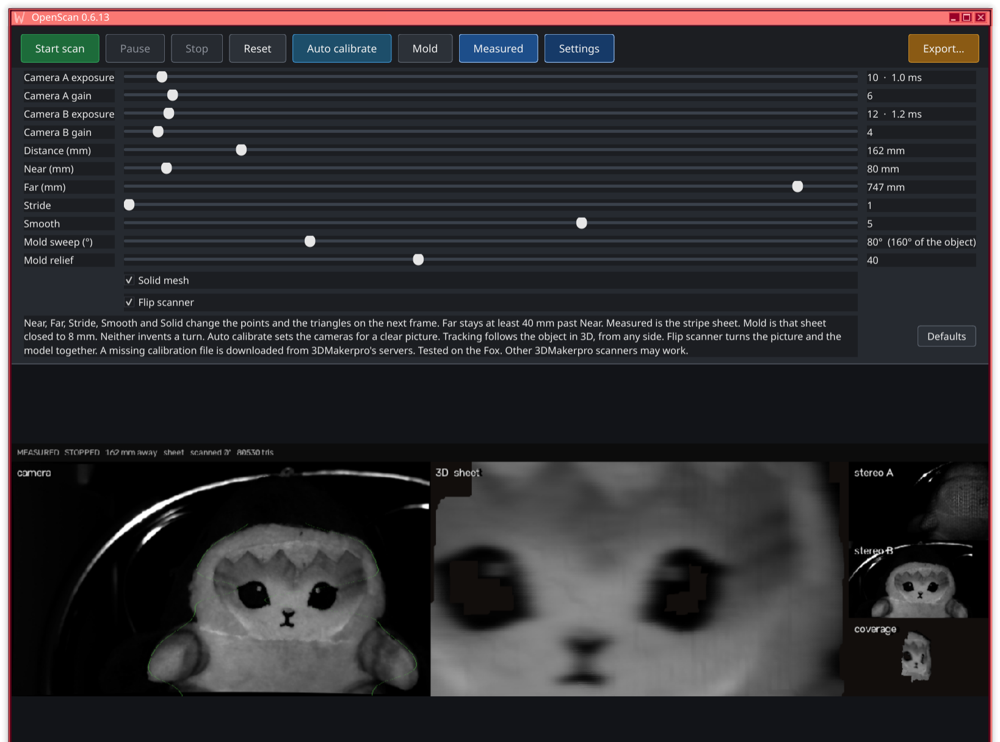

# OpenScan



OpenScan is a personal scanner for one USB camera pair. It was vibe-coded for one job. It is not maintained, and it is not a product. Change it with your own assistant.

Plug the scanner in. Your user has to be in the `video` group. Copy your calibration to `~/.local/share/openscan/calib/` and name it with the serial and `.txt`. The download does not include that file. On the desktop, a local lookup key downloads a missing file instead. See [Factory lookup](#factory-lookup).

Day to day use is in [docs/usage.md](docs/usage.md). Notes are in [CHANGELOG.md](CHANGELOG.md). The license is MIT. See [LICENSE](LICENSE).

## Run a download

Each download is one file. The `*` below is the version in the name, so the same commands work next time too.

**Linux**

```bash
chmod +x OpenScan-*-linux-x86_64
./OpenScan-*-linux-x86_64
```

The window opens. A normal desktop already has the X11 library this file uses.

The AppImage is the same program, with that library included:

```bash
chmod +x OpenScan-*.AppImage
./OpenScan-*.AppImage
```

If Linux cannot mount the AppImage, add `--appimage-extract-and-run` before any command.

**Windows.** Open the `.exe`.

**Android.** Install the `.apk`. Android warns that the file is signed with a debug key. That warning is expected.

There is no macOS download.

```bash
./OpenScan-*-linux-x86_64 help
./OpenScan-*-linux-x86_64 devices
```

`help` lists the commands. `devices` prints the cameras when both belong to one scanner.

## A scan

The window opens idle, so you can frame the object before anything is kept.

The top row is Start, Pause, Stop, Reset, Mold, Measured, Auto calibrate, and Export. The sliders under it are exposure and gain for each camera, distance, near, far, stride, smooth, mold sweep, and mold relief. Solid mesh keeps the triangles. Flip scanner turns the camera picture upside down. Defaults puts the sliders back.

The camera is on the left, the 3D view is in the middle, and stereo A, stereo B, and the side view are on the right. Drag the 3D view to turn it.

Press Start and turn the object. With Mold selected, Start reads Molding. The status line shows triangles and degrees. Stop holds the model. Pause holds it and keeps the turn. Reset drops it. Export opens the system save dialog. The file ending chooses STL, OBJ, or PLY. Quit with `q` or Esc. A model is then written as `openscan-last.stl`, `openscan-last.obj`, and `openscan-last.ply`.

Mold builds from projector points that have been seen twice. The shapes of those points locate the object, so the scanner can move around it. A single glance is stored and does not mold. Measured is the projector surface in front of the scanner. When the object turns, a new view is kept where it meets that surface. Switching Mold, Measured, and Cloud clears the model.

A still picture stays where it is. The turn comes from the stored shapes, so the scanner can move around the object. One camera pair was used. Other scanners are untested.

OpenScan is not affiliated with any scanner maker. Their names stay theirs, and their installers are not part of this project. The cameras are ordinary USB video devices on the `uvcvideo` driver. This project does not install a kernel module. The NIR lamp has no USB command of its own. It lights while camera A is streaming, and that path is [docs/projector.md](docs/projector.md).

## Command line

```text
openscan                         window
openscan devices                 the camera pair
openscan grab -o DIR             camA.pgm and camB.pgm
openscan scan -o object.stl --seconds 8
openscan turn-test
openscan help
```

From a source build the program is `./build/openscan`. `openscan version` prints the version and the host (`linux`, `windows`, or `mac`).

`scan` records without a window. `--shape mold` is the confirmed projector solid. `--shape measured` is the projector surface, and a later view is kept where it meets that surface. `--distance` is 100–500 mm and is the depth of the center column. Exposure flags are `--exposure-a`, `--gain-a`, `--exposure-b`, and `--gain-b`.

Exposure is in steps of 100 microseconds. Gain is 0..100, the value written to the camera. A starting point that worked here is camera A exposure 12 gain 4, and camera B exposure 16 gain 4. If the camera stays on auto, the status line says the sliders were not applied. On Android, when the sensor's ISO range is wider than 0..100, 0 is the bottom of that range and 100 is the top.

## Calibration

Each scanner has its own file, `calib/<serial>.txt`. The serial is read from the cameras. Both cameras have to carry the same serial, or the pair is not opened. This repository does not include a calibration file.

Search order:

1. `calib/<serial>.txt` in the current directory, then `openscan/calib/<serial>.txt`
2. `calib/<serial>.txt` next to the sources
3. Beside an installed program, `../share/openscan/calib/<serial>.txt`
4. `$XDG_DATA_HOME/openscan/calib/<serial>.txt`, or `~/.local/share/openscan/calib/<serial>.txt`
5. On Windows, `%APPDATA%/openscan/calib/<serial>.txt`
6. On macOS, `~/Library/Application Support/openscan/calib/<serial>.txt`

The saved mesh does not contain the serial or the calibration text.

### Factory lookup

When none of the files above exist, desktop OpenScan can download this scanner's calibration. Put the lookup key in `OPENSCAN_CALIB_SIGN`, or as one line in `calib/sign.local`. That key is not in the source tree, and both names are gitignored.

The request goes out through the `curl` program. It asks the factory server for this serial only. The calibration text is not uploaded. The download is saved in the home-folder location above, and it is kept only when its DevID is this serial. Without the key, nothing is requested and you place the file yourself. The window still opens.

The Android app does not send that request. No key is built into it, so a missing file on the phone stays missing. It uses a file already stored for the serial, then a shipped asset of that name.

On Android the pair is kept only when both cameras share that serial. Swap exchanges the two cameras, the button reads Swapped, and that exchange stays on the next time the app opens. The status line names the serial. The camera rules below are the rest of that behavior.

- The serial is read from the `KYT Camera A/B` name. When that name is hidden, the USB serial on the same two cameras is used, and both still have to match.
- A connected unit is not scanned with a different serial's file. With no scanner plugged in, other cameras stay closed.
- If those video devices are blocked, the camera API is used only when both USB cameras share the loaded serial.
- A camera id that names a scanner video node is that camera, even when another camera is also connected. That pair uses camera A as the pattern camera unless Swap is on.
- Opaque ids are used only when they are the only pair and no other USB camera is plugged in. Those choose the pattern by which picture has more contrast, then Swap.
- The camera API streams at the calibration size. A different size is not stretched over the intrinsics, and a different picture is not scaled. Both images are required.
- A pair is measured only after that scanner's calibration is loaded. A shipped file is not used to measure pictures while no scanner has been seen.
- A device that streams isochronous video without the video class still counts as another camera.

## USB names

The udev rule is optional. It names the nodes `/dev/openscan-a` and `/dev/openscan-b` and lets the `video` group open them.

```bash
sudo install -m 0644 udev/99-openscan.rules /etc/udev/rules.d/99-openscan.rules
sudo udevadm control --reload
sudo udevadm trigger --subsystem-match=usb --attr-match=idVendor=0c45
sudo udevadm trigger --subsystem-match=video4linux
```

## Build

`build/` and `dist/` are generated. They are gitignored.

The Linux build was tried on CachyOS with CMake 4.4.3 and GCC 16.2.1. CMake 3.16 is enough. The program is C11 and links libX11 and libjpeg. Windows uses Win32, Media Foundation, and WIC. macOS uses Cocoa, AVFoundation, and ImageIO. Headers for Video4Linux come with the C library. On Arch and CachyOS:

```bash
sudo pacman -S cmake gcc libx11 libjpeg-turbo
cmake -S . -B build
cmake --build build
./build/openscan
```

The engine is `build/libopenscan.a`. Another program includes `openscan/openscan.h` and links that library.

```bash
./build/openscan help
./build/openscan devices
./build/openscan turn-test
./packaging/appimage.sh
```

`packaging/appimage.sh` writes two files in `dist/`:

- `OpenScan-<version>-linux-x86_64` is one program. When `libjpeg.a` is installed, or `OPENSCAN_LIBJPEG_A` points at that archive, JPEG is built into the file and it needs libX11 only. Otherwise it also needs `libjpeg.so.8`.
- `OpenScan-<version>-x86_64.AppImage` is the same program with its libraries packed in, apart from the C library. This step needs `appimagetool` on `PATH`, or `APPIMAGETOOL` set to that program.

Neither file contains a calibration.

Windows, from Linux, with the MinGW cross compiler installed:

```bash
cmake -S . -B build-win -DCMAKE_TOOLCHAIN_FILE=packaging/mingw-w64.cmake
cmake --build build-win
```

On Windows itself, the same `cmake -S . -B build` with MinGW or MSVC. macOS uses that command too. The Windows download is `build-win/openscan.exe`.

No vendor installer, account, or browser cookie is required to build or run OpenScan. A missing calibration can call the `curl` program. That happens only when the local key above is set.

### Android APK

The Android app is `android/`. It compiles the same C sources. The native library links `log` and `android`.

You need JDK 17, the Android SDK, NDK `28.2.13676358`, and CMake `3.22.1`. `android/local.properties` is not committed. It only needs:

```text
sdk.dir=/path/to/Android/Sdk
```

From `android/`:

```bash
export JAVA_HOME=/path/to/jdk-17
./gradlew :app:assembleDebug
adb install -r app/build/outputs/apk/debug/app-debug.apk
```

The application id is `dev.lab.openscan`. Copy the APK to `dist/OpenScan-<version>.apk` when you are packing a release. That directory is gitignored.

## Layout

| Path | Contents |
| --- | --- |
| `include/openscan/` | Camera, calibration, and the live session. |
| `src/device/` | Cameras. Video4Linux on Linux, Media Foundation on Windows, AVFoundation on macOS. |
| `src/calib/` | Read a calibration file. Lookup, when a local key is set, calls the `curl` program. |
| `src/live/` | Mold, turn, mesh, and preview. |
| `src/ui/` | The window loop. X11, Win32, or Cocoa draws it. |
| `android/` | Android app. The scan engine is the C in this tree. |
| `calib/` | Where you put your own calibration file. None is committed. |
| `udev/` | Device naming rule. |
